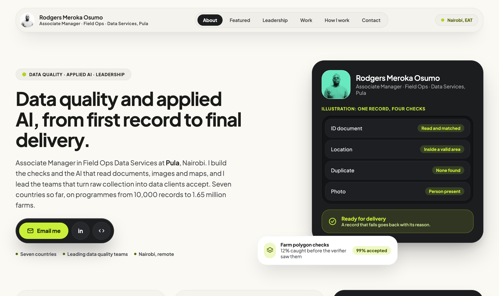

### Data quality and applied AI, from first record to final delivery

Associate Manager in Field Ops Data Services at Pula, Nairobi. I build the checks and the AI that read documents, images and maps, and I lead the teams that turn raw collection into data clients accept.

- 1.65 million farms verified on a national coffee mapping programme in Uganda
- 460,000+ farmer records delivered to a national agricultural agency in Ethiopia
- 850,000+ parcel images read by the AI checks I built

**[See the full page](https://rodgersmerokaosumo.github.io)** · [LinkedIn](https://www.linkedin.com/in/rodgersmerokaosumo/) · [Email](mailto:rodgersmerokaosumo@gmail.com)
